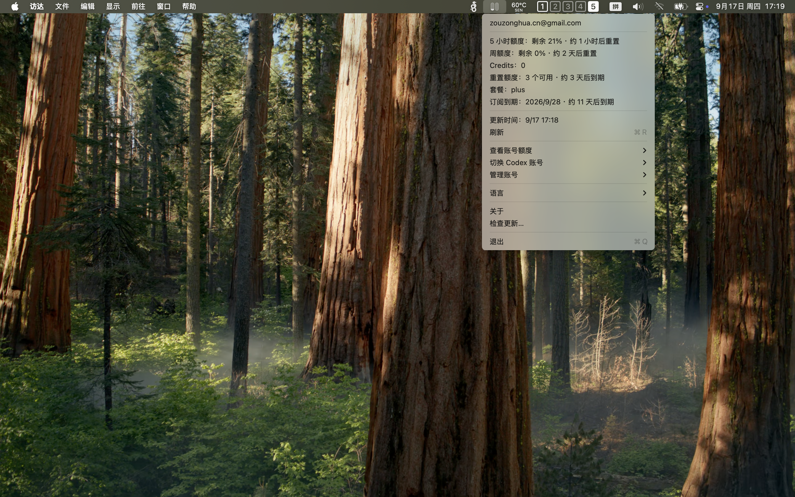

# CodexUsage

CodexUsage 提供 macOS 菜单栏应用和 [Linux CLI](#linux-cli)。菜单栏应用支持：

- 查看 Codex 5 小时 / 周额度与重置时间
- 查看可用的 Codex 重置额度及最近到期时间
- 切换已保存的 Codex 账号

<p align="center">
  
</p>

## 设计取舍

- SwiftPM 原生实现，零第三方依赖，macOS 14+。
- 只读取 `~/.codex/auth.json`（或 `CODEX_HOME/auth.json`）和应用自己保存的账号目录。
- 通过 Codex OAuth 使用接口读取额度；凭据临近过期或接口返回 401 时，通过 Codex CLI 自动续期，每次查询最多续期一次、重试一次。不读取浏览器 Cookie，不打印 token。
- “查看账号额度”只改变查询对象；“切换 Codex 账号”会保存当前账号的最新凭据，再原子替换 `auth.json`，因此 Codex CLI 会同步切换。
- 添加、重新登录和续期都在应用的独立临时目录中完成，再写回对应账号；应用管理的凭据使用文件存储，不修改全局配置。

## 账号管理

- 自动续期需要支持 App Server 的 Codex CLI。失败时按提示检查网络或 CLI 版本，也可在“管理账号”中选择对应账号“重新登录…”。
- 重新登录会更新原账号；如果登录了其他账号或工作区，会保留原凭据。重复添加同一账号不会增加重复记录。
- 在终端运行 `codex login` 后，打开菜单或刷新会同步更新同一账号的已保存副本；其他账号需要分别登录。
- “管理账号 → 账号 → 删除账号…”会删除本应用保存的凭据和额度缓存。当前 Codex 使用中的账号需要先切换到其他账号才能删除。
- 登录期间可在“管理账号”中取消；取消、失败或超时均保留原凭据。
- HTTP 403 表示访问被拒绝，不会被当作登录过期；API Key 登录不支持查询 ChatGPT 订阅额度。

## 运行

```sh
swift run CodexUsage
```

## Linux CLI

Beta 和正式 GitHub Release 均提供 Linux x86_64 ELF 二进制 `codex-usage-linux` 和同名 `.sha256` 校验文件。下载到同一目录后运行：

```sh
sha256sum -c codex-usage-linux.sha256
chmod +x codex-usage-linux
./codex-usage-linux status
```

如果希望用短命令 `cu`，可将下载的二进制安装到 `~/.local/bin`，并确保该目录在 `PATH` 中：

```sh
mkdir -p ~/.local/bin
install -m 755 codex-usage-linux ~/.local/bin/cu
cu --help
cu help switch
cu status --json
```

Linux CLI 用 Go 构建，下载后可以直接运行。它通过 ChatGPT 的默认服务地址查询额度，续期时调用官方 Codex CLI。源码构建可用 `bash Scripts/package_linux_cli.sh`。

`import` 默认保存当前登录，也可以导入指定目录中的 `auth.json`。账号 ID 从 `accounts` 获取，`*` 标记当前文件中的账号。导入和查询需要 ChatGPT OAuth 登录。

在 Linux 上，账号归档默认保存在 `~/.local/share/CodexUsage`。将 `XDG_DATA_HOME` 设为绝对路径时，归档保存在 `$XDG_DATA_HOME/CodexUsage`。

在有效的 Codex home（`CODEX_HOME` 或 `~/.codex`）下，将 `config.toml` 的顶层配置设为 `cli_auth_credentials_store = "file"`。切换后新开 Codex 会话以读取更新后的凭据。

## 验证

Linux CI 使用发布打包脚本，验证静态链接的 Linux x86_64 ELF 和 SHA256，并对发布成品运行冒烟测试。

```sh
swift test
swift build
```

重置额度仅展示服务端返回的可用数量和到期时间；应用不会自动兑换或修改额度。

## 研发与发布工作流

项目采用 **GitHub Flow / Trunk-Based Development** 单主干模式，由 GitHub Actions 与 Release Please 驱动：

1. **持续集成 (CI)**：向 `main` 提交 Pull Request 时会自动触发代码编译与单元测试。
2. **自动化 Beta 预览**：
   - 特性分支合并至 `main` 后，会自动根据 Conventional Commits 分析变更，计算下一个版本号并生成 Beta Tag（例如 `v0.2.0-beta.1`）。
   - 自动构建并发布包含 macOS DMG、Linux CLI 二进制和各自的 SHA256 校验文件的 GitHub Pre-release。
3. **正式发布 (Release Please)**：
   - 合并至 `main` 时，Release Please 会自动维护一个「正式发布待审 PR」（自动汇总 `CHANGELOG.md` 并更新版本号）。
   - 当积累的功能稳定、准备发布正式版本时，只需在 GitHub 页面上**手动批准并合并该 Release PR**。
   - 合并后流水线会自动打上正式 Tag（例如 `v0.2.0`），构建 macOS DMG 和 Linux CLI 二进制，并将它们与各自的 SHA256 校验文件上传到正式 GitHub Release。

版本递增规则（遵循 Conventional Commits）：

- `fix:` / `perf:`：递增补丁版本 (Patch)
- `feat:`：递增次版本 (Minor)
- `BREAKING CHANGE:` 或提交类型后带 `!`：递增主版本 (Major)

当前发布包仍使用 ad-hoc 签名，暂未配置 Developer ID 签名和 Apple 公证；首次打开时 macOS 可能需要在「系统设置 → 隐私与安全性」中手动允许。
